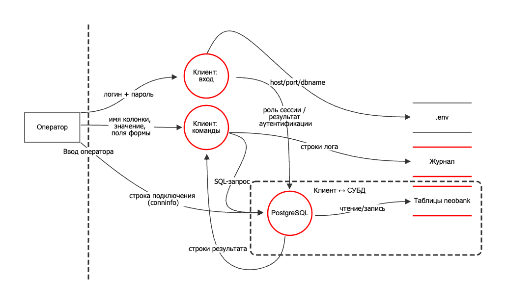

# Задание №4 — Модель угроз приложения neobank (STRIDE + DREAD)

Анализируется приложение из задания №3 — интерактивный клиент к БД необанка
(CBS) на Rust + PostgreSQL. Модель угроз построена в OWASP Threat Dragon,
исходный файл — `task4.json`.

## 1. Описание системы

Оператор (сотрудник банка) работает с данными клиентов через TUI-клиент.
Клиент подключается к PostgreSQL под ролью `bank_employee`, выполняет фильтрацию,
вставку, обновление и онбординг. Логин и пароль роли вводятся оператором.
Приложение существует в двух версиях — уязвимой (конкатенация SQL и строки
подключения) и защищённой (плейсхолдеры, белый список колонок, поля `Config`).

## 2. Диаграмма потоков данных

Элементы: внешняя сущность **Оператор**; процессы **Клиент: вход**, **Клиент:
команды**, **PostgreSQL**; хранилища **Таблицы neobank**, **Журнал**. Границы
доверия: «Ввод оператора» (всё от человека недоверенное) и «Клиент ↔ СУБД».

## 3. Локализованные угрозы (STRIDE)

| № | Элемент | STRIDE | Угроза | Суть |
|---|---------|--------|--------|------|
| 1 | Клиент: вход | Spoofing | Вход под чужой ролью | conninfo-инъекция `options='-c role=bank_admin'` в поле логина → сессия как `bank_admin` без его пароля |
| 2 | Клиент: вход | Elevation | Эскалация до bank_admin | тот же приём переключает роль сессии; права админа у обычного оператора |
| 3 | Клиент: команды | Tampering | SQL-инъекция в UPDATE | `' OR '1'='1` в условии меняет все строки, подмена баланса |
| 4 | Клиент: команды | Tampering | Снятие ограничения БД | многооператорная инъекция `; ALTER TABLE … DROP CONSTRAINT …` убирает `CHECK (balance>=0)` |
| 5 | Клиент: команды | Info disclosure | Чтение чужих данных | инъекция в значение/имя колонки возвращает счета всех клиентов |
| 6 | Клиент: команды | Denial of service | Истощение / отказ | инъекция `pg_sleep` или `DROP TABLE` |
| 7 | PostgreSQL | Elevation | Мисконфигурация ролей | `GRANT bank_admin TO bank_employee` (NOINHERIT) делает эскалацию возможной |
| 8 | Таблицы neobank | Tampering | Нарушение целостности | отрицательный баланс после снятия ограничения |
| 9 | Журнал | Info disclosure | Утечка схемы через лог | сырые ошибки драйвера (имена таблиц, ограничений, SQLSTATE) в файле |
| 10 | Журнал | Repudiation | Нет атрибуции | одна роль `bank_employee` на всех — не видно, кто выполнил действие |

## 4. Оценка рисков (DREAD)

Каждый критерий 1–10, риск = (D+R+E+A+D)/5.

| № | Угроза | Damage | Reproducibility | Exploitability | Affected | Discoverability | Риск |
|---|--------|:------:|:---------------:|:--------------:|:--------:|:---------------:|:----:|
| 3 | SQL-инъекция в UPDATE | 8 | 9 | 9 | 8 | 8 | **8.4** |
| 1 | Вход под чужой ролью | 9 | 9 | 8 | 9 | 6 | **8.2** |
| 5 | Чтение чужих данных | 7 | 9 | 9 | 8 | 8 | **8.2** |
| 2 | Эскалация до bank_admin | 9 | 9 | 8 | 9 | 5 | **8.0** |
| 7 | Мисконфигурация ролей | 9 | 9 | 7 | 9 | 4 | **7.6** |
| 4 | Истощение / отказ | 7 | 8 | 7 | 8 | 6 | **7.2** |
| 6 | Снятие ограничения БД | 9 | 8 | 6 | 7 | 5 | **7.0** |
| 8 | Нарушение целостности | 8 | 8 | 6 | 7 | 5 | **6.8** |
| 10 | Нет атрибуции | 5 | 9 | 3 | 6 | 5 | **5.6** |
| 9 | Утечка схемы через лог | 4 | 7 | 4 | 4 | 5 | **4.8** |

### Обоснование оценок

- **3. SQL-инъекция** — ущерб высокий (подмена финансовых данных), повторяемость полная, эксплуатация тривиальна (`' OR '1'='1`), задевает все счета, находится в любом поле ввода.
- **1. Вход под чужой ролью** — ущерб максимальный (полный доступ), детерминированно, одна строка в логине; обнаружимость средняя (нужно знать разбор conninfo).
- **5. Чтение чужих данных** — утечка конфиденциальных данных, тривиальная инъекция, легко обнаружить.
- **2. Эскалация до bank_admin** — тот же вектор, что №1, но оценивается как рост прав; обнаружимость чуть ниже.
- **7. Мисконфигурация ролей** — включающее условие эскалации, присутствует всегда, но требует анализа грантов (низкая обнаружимость).
- **4. Истощение / отказ** — сервис падает или теряет данные; требует инъекции и знания.
- **6. Снятие ограничения БД** — высокий ущерб (овердрафт), но требует предварительной эскалации и многооператорной инъекции (сложнее).
- **8. Нарушение целостности** — результат №6 на уровне данных.
- **10. Нет атрибуции** — не эксплойт, а пробел подотчётности; ущерб косвенный.
- **9. Утечка схемы через лог** — требует доступа к файлу, ущерб косвенный (помогает атакующему).

## 5. Итоговая таблица угроз (по убыванию риска)

| Место | Угроза | STRIDE | Риск |
|:-----:|--------|--------|:----:|
| 1 | SQL-инъекция в UPDATE | Tampering | 8.4 |
| 2 | Вход под чужой ролью | Spoofing | 8.2 |
| 3 | Чтение чужих данных | Information disclosure | 8.2 |
| 4 | Эскалация до bank_admin | Elevation | 8.0 |
| 5 | Мисконфигурация ролей | Elevation | 7.6 |
| 6 | Истощение / отказ | Denial of service | 7.2 |
| 7 | Снятие ограничения БД | Tampering | 7.0 |
| 8 | Нарушение целостности | Tampering | 6.8 |
| 9 | Нет атрибуции | Repudiation | 5.6 |
| 10 | Утечка схемы через лог | Information disclosure | 4.8 |

## 6. Топ-5 и соответствие ФСТЭК БДУ

Соответствие угрозам из [банка данных угроз ФСТЭК России](https://bdu.fstec.ru/threat).

| Угроза | Риск | УБИ.xxx | Название из БДУ |
|--------|:----:|---------|-----------------|
| SQL-инъекция в UPDATE | 8.4 | УБИ.187 | Угроза несанкционированного воздействия на систему посредством SQL-инъекции |
| Вход под чужой ролью | 8.2 | УБИ.031 | Угроза использования механизмов авторизации для повышения привилегий |
| Чтение чужих данных | 8.2 | УБИ.2 | Угроза несанкционированного доступа |
| Эскалация до bank_admin | 8.0 | УБИ.007 | Угроза повышения привилегий в системе |
| Мисконфигурация ролей | 7.6 | УБИ.031 | Угроза использования механизмов авторизации для повышения привилегий / нарушения правил разграничения доступа |